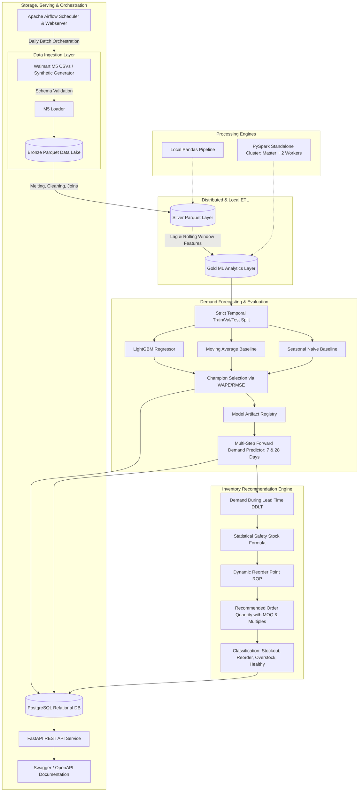

# Smart Inventory and Demand Forecasting System

[](https://github.com)
[](https://www.python.org/)
[](https://fastapi.tiangolo.com)
[](https://spark.apache.org)
[](https://www.postgresql.org)

An end-to-end, production-grade Data Science, Data Engineering, and MLOps system built to tackle two central challenges in retail operations: **Stockouts** (lost revenue and dissatisfied customers) and **Overstocking** (tied-up working capital, carrying costs, and spoilage).

---

## 1. Architecture Overview

The system implements a medallion lakehouse design (Bronze → Silver → Gold) paired with multi-step recursive ML forecasting (LightGBM vs Baselines) and a statistical inventory recommendation engine.



---

## 2. Technology Stack & Rationale

| Component | Technology | Rationale |
| :--- | :--- | :--- |
| **Data Lake** | Parquet / Snappy | Columnar format with schema enforcement, compact storage, and partition pruning. |
| **Data Processing** | Pandas & PySpark | Dual execution: Pandas for rapid development and PySpark standalone for distributed big data processing. |
| **Distributed Cluster**| Apache Spark 3.5.0 | Standalone mode with 1 master and 2 worker containers running real windowed jobs. |
| **Relational Database**| PostgreSQL 15 | Persistent ACID storage for catalogs, sales, forecasts, evaluations, and alerts. |
| **ORM & Migrations** | SQLAlchemy 2.0 & Alembic | Idempotent schema evolution and type-safe database queries. |
| **Forecasting Engine**| LightGBM & Scikit-learn| Gradient-boosted decision trees suited for tabular retail demand with non-linear calendar interactions. |
| **Model Registry** | Custom JSON/Joblib | Lightweight, reproducible artifact and evaluation metadata tracking. |
| **Backend REST API** | FastAPI & Pydantic | High-performance asynchronous API with automatic OpenAPI (Swagger) docs and API key security. |
| **Orchestration** | Apache Airflow 2.8.2 | DAG-based workflow scheduling, retries, and monitoring for daily retail replenishment. |
| **Containerization** | Docker & Docker Compose | Uniform runtime across environments with isolated networks and healthchecks. |

---

## 3. Repository Structure

```
smart-inventory-forecasting/
├── Makefile                               # Developer automation shortcuts
├── README.md                              # System documentation
├── pyproject.toml                         # Project package and tool configuration
├── requirements.txt                       # Pinned dependencies
├── docker-compose.yml                     # Multi-container orchestration
├── config/
│   └── settings.yaml                      # System and model configuration
├── data/                                  # Medallion lakehouse storage
│   ├── raw/                               # Optional original Kaggle M5 CSVs
│   ├── bronze/                            # Unmutated Parquet data
│   ├── silver/                            # Cleaned and joined daily sales
│   ├── gold/                              # Feature-engineered ML datasets
│   └── synthetic/                         # Reproducible synthetic test datasets
├── artifacts/
│   ├── models/                            # Champion model binaries & metadata
│   └── metrics/                           # Evaluation reports
├── src/
│   └── inventory_forecasting/
│       ├── config.py                      # Pydantic BaseSettings & env resolution
│       ├── ingestion/                     # Bronze ingestion & validation
│       │   ├── m5_loader.py
│       │   ├── synthetic_generator.py
│       │   └── validation.py
│       ├── processing/                    # Silver & Gold pipelines
│       │   ├── feature_engineering.py
│       │   ├── pandas_pipeline.py
│       │   └── spark_pipeline.py
│       ├── database/                      # Relational persistence
│       │   ├── models.py
│       │   ├── session.py
│       │   ├── repository.py
│       │   └── migrations/
│       ├── forecasting/                   # Machine learning models
│       │   ├── baselines.py
│       │   ├── evaluate.py
│       │   ├── model_registry.py
│       │   ├── train.py
│       │   └── predict.py
│       ├── inventory/                     # Inventory decision engine
│       │   ├── calculations.py
│       │   ├── alerts.py
│       │   └── recommendations.py
│       ├── api/                           # FastAPI application
│       │   ├── main.py
│       │   ├── dependencies.py
│       │   └── schemas.py
│       └── pipelines/                     # Full pipeline runner
│           └── run_pipeline.py
├── airflow/
│   └── dags/                              # Airflow DAGs
│       └── smart_inventory_dag.py
├── docker/                                # Dockerfiles and DB scripts
│   ├── api/Dockerfile
│   ├── airflow/Dockerfile
│   └── init-db.sh
├── scripts/                               # CLI execution scripts
│   ├── setup.sh
│   ├── generate_sample_data.py
│   ├── run_ingestion.py
│   ├── train_model.py
│   ├── generate_forecasts.py
│   ├── run_spark_job.py
│   └── validate_cluster.py
├── tests/                                 # Automated tests (16 tests, 100% pass)
│   ├── unit/
│   └── api/
└── .github/workflows/tests.yml            # CI test pipeline
```

---

## 4. Quickstart: Setup and Execution

### Prerequisites
- Python 3.9+ (or 3.11/3.12)
- Docker & Docker Compose (for full-stack deployment)

### 1. Local Development Mode (Laptop-Friendly)

Clone and set up the project:
```bash
# 1. Initialize environment, install dependencies, and run full pipeline
bash scripts/setup.sh

# Or using Makefile
make setup
```

Run automated tests:
```bash
make test
# Result: 16 passed
```

Run FastAPI Backend locally:
```bash
make run-api
```
- Interactive API Docs (Swagger): `http://localhost:8000/docs`
- Healthcheck: `http://localhost:8000/health`

---

## 5. Full-Stack Docker Deployment

To launch all 7 services (PostgreSQL, Spark Master, 2 Spark Workers, FastAPI, Airflow Webserver, Airflow Scheduler):

```bash
docker compose up -d
```

### Exposed Service Endpoints

| Service | Host Port | Purpose |
| :--- | :--- | :--- |
| **FastAPI Backend** | `8000` | REST API endpoints & Interactive Swagger Docs (`/docs`) |
| **Spark Master UI** | `8080` | Cluster overview, worker registration, and job telemetry |
| **Spark Worker 1** | `8081` | Worker 1 metrics and executor logs |
| **Spark Worker 2** | `8082` | Worker 2 metrics and executor logs |
| **Airflow Webserver**| `8085` | Airflow DAG visualizer and pipeline scheduler (`admin` / `admin`) |
| **PostgreSQL DB** | `5432` | Relational database (`inventory_db` & `airflow_db`) |

### Validating Spark Cluster Workers

Execute the cluster verification script to confirm both workers are registered:
```bash
make spark-validate
# or
python scripts/validate_cluster.py http://localhost:8080/json/
```

Submit a real PySpark ETL job to the Spark cluster:
```bash
python scripts/run_spark_job.py --master spark://localhost:7077
```

---

## 6. Real Dataset (Walmart M5) Instructions

To run with real-world sales data from the Kaggle Walmart M5 competition:
1. Download `sales_train_validation.csv`, `calendar.csv`, and `sell_prices.csv` from [Kaggle M5 Forecasting Accuracy](https://www.kaggle.com/competitions/m5-forecasting-accuracy/data).
2. Place the CSV files directly in `data/raw/`.
3. Ingest and process:
```bash
python scripts/run_ingestion.py --source data/raw --synthetic=False
```
If real data is not downloaded, the system automatically uses reproducible synthetic data with realistic seasonality, trends, and promotions.

---

## 7. Statistical Inventory Formulation

1. **Demand During Lead Time ($DDLT$)**:
   $$\text{DDLT} = \sum_{t=1}^{L} \hat{y}_t$$
   Where $L$ is supplier lead time in days, and $\hat{y}_t$ is forecast demand at step $t$.

2. **Statistical Safety Stock ($SS$)**:
   $$\text{SS} = z \cdot \sqrt{L \cdot \sigma_d^2 + \bar{d}^2 \cdot \sigma_L^2}$$
   Where $z$ is the standard normal factor corresponding to target service level (e.g., $z=1.645$ for 95%), $\sigma_d$ is demand standard deviation, and $\sigma_L$ is lead time standard deviation.

3. **Reorder Point ($ROP$)**:
   $$\text{ROP} = \text{DDLT} + \text{SS}$$

4. **Inventory Position ($IP$)**:
   $$\text{IP} = \text{Stock On Hand} + \text{Incoming Stock} - \text{Committed Stock}$$

5. **Recommended Order Quantity ($ROQ$)**:
   $$\text{ROQ} = \begin{cases} \lceil \text{Target Stock} - \text{IP} \rceil_{\text{MOQ, Multiple}}, & \text{if } \text{IP} \le \text{ROP} \\ 0, & \text{otherwise} \end{cases}$$
