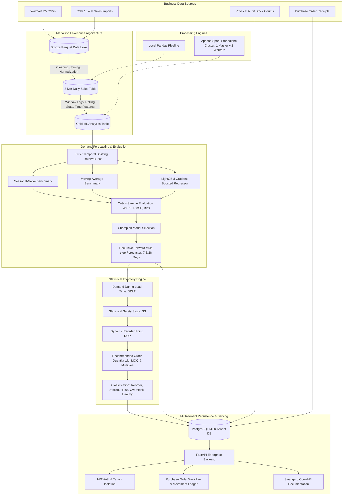

# System Architecture & Technical Specifications

## 1. High-Level Architecture Flow

## 2. Multi-Tenant Business Isolation
Each business registers independently. All relational queries across products, daily sales, forecasts, inventory snapshots, stock movements, and purchase orders are strictly partitioned by `business_id`. A request from Business B attempting to access records of Business A returns an HTTP 404/403.
